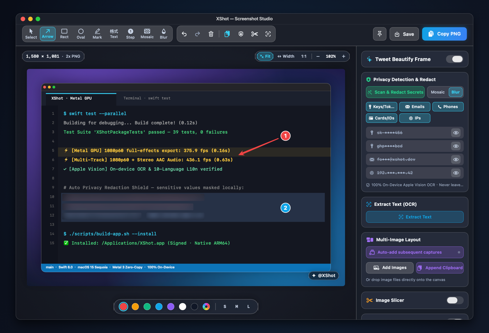
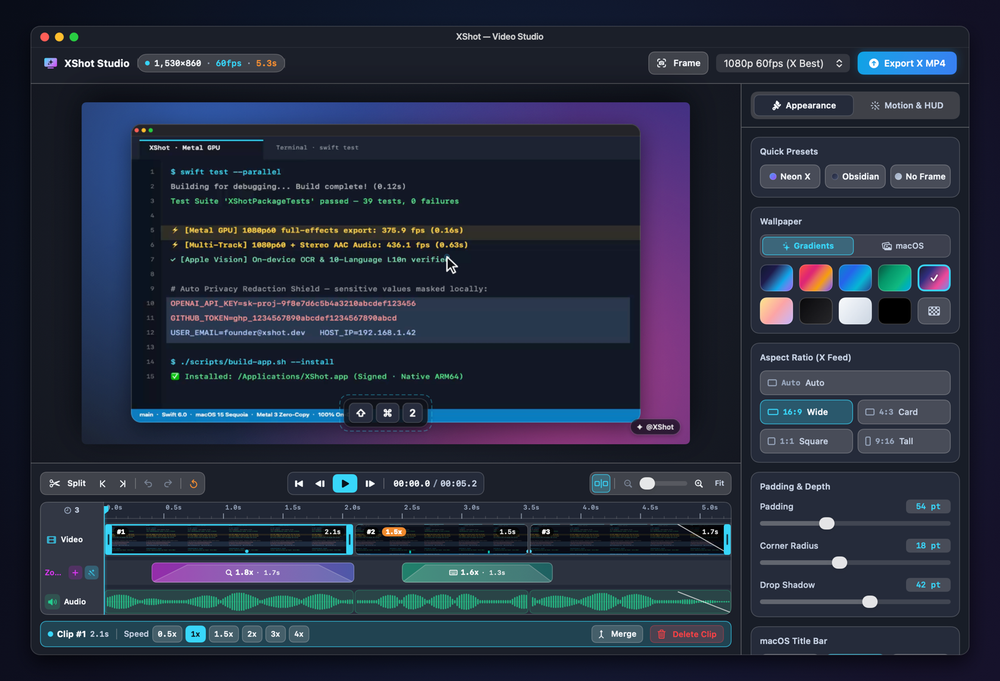
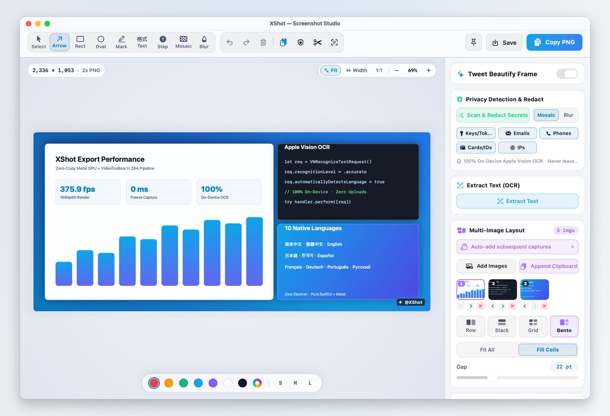
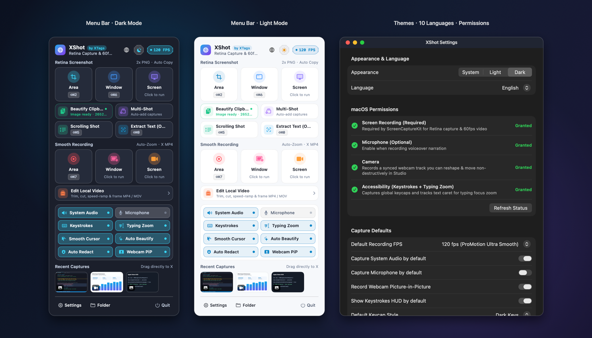

# XShot `by XTags`

> Pure native macOS Retina screenshot beautification, scrolling long capture, offline OCR, and 60/120fps screen-recording studio crafted for **X (Twitter)** creators — built 100% in **Swift / SwiftUI / AppKit / ScreenCaptureKit / Apple Vision / Metal / VideoToolbox**. Zero Electron, ultra-fast, 100% on-device privacy.

English | [简体中文](README.zh-CN.md)

[](#get-xshot-pro)
[](https://xtags.top)
[](https://xtags.top/install)
[](https://github.com/zsai001/xshot/releases/latest)
[](LICENSE)
[](#requirements)
[](#build-from-source)

> [!IMPORTANT]
> **Looking for continuous updates, macOS compatibility fixes, and priority bug support?**
> This GitHub repository is the **open-source community snapshot (`v1.0.0`, MIT)** and will **no longer sync future commercial updates**.
> - **[Get XShot Pro (Mac App Store)](#get-xshot-pro)** — Official actively maintained edition · Free Trial · `$6/mo` *(auto-upgrades permanently to Lifetime after 6 paid months)* · `$36` Lifetime
> - **[Explore XTags (`xtags.top`)](https://xtags.top)** — AI account tagging, noise-free feed shield & creator toolkit for X (Twitter) · **[Install Browser Extension](https://xtags.top/install)**

<p align="center">
  
</p>

---

## Get XShot Pro

This repository provides the **open-source `v1.0.0` snapshot** under the MIT License for learning, auditing, and self-building. All ongoing feature releases, macOS updates, and priority bug fixes ship exclusively in the official **XShot Pro (Mac App Store)** release and the **XTags** ecosystem.

| | Open-Source Snapshot (GitHub `v1.0.0`) | **XShot Pro (Mac App Store · Official)** |
| :--- | :--- | :--- |
| **Maintenance & Updates** | Frozen `v1.0.0` snapshot *(future updates not synced)* | **Actively maintained** with timely feature & macOS updates |
| **Installation & Signing** | Ad-hoc signed binary (manual Gatekeeper approval) or build from source | **Apple Notarized & App Sandbox verified** Universal binary (`Apple Silicon + Intel`) |
| **Bug Reports & Fixes** | Community GitHub Issues | **Priority bug feedback, rapid fixes & timely App Store updates** |
| **Pricing** | Free (MIT) | **Free Trial** · **`$6/mo`** *(auto-upgrades permanently to Lifetime at 6 paid months)* · **`$36` One-Time Lifetime** |

### Official Links

- **XShot Pro on Mac App Store**: Search **`XShot`** on the Mac App Store *(Bundle ID: `top.xtags.xshot`)* or visit **[xtags.top](https://xtags.top)** for the direct store link and latest release notes.
  - **Fair Loyalty Pricing**: Start with a **Free Trial**, subscribe for **`$6/mo`** with priority bug fixes & timely updates — and once you reach **6 paid months (`$36` total)**, XShot **automatically upgrades you to Lifetime Updates forever**. Prefer one-time? Unlock **Lifetime** immediately for **`$36`**.
- **XTags Official Website**: **[https://xtags.top](https://xtags.top)** — *Smart AI tagging, feed shield, creator radar & post studio for X (Twitter).*
- **XTags Browser Extension (Chrome / Edge)**: **[https://xtags.top/install](https://xtags.top/install)**
- **XTags Plans & Pricing**: **[https://xtags.top/pricing](https://xtags.top/pricing)**
- **Open-Source Community Snapshot (`v1.0.0`)**: **[GitHub Releases](https://github.com/zsai001/xshot/releases/latest)**
- **Priority Support & Bug Reports**: **[GitHub Issues](https://github.com/zsai001/xshot/issues)** · **[zsai001@xdev.sh](mailto:zsai001@xdev.sh)**

---

## Screenshots

### 60/120fps Video Studio & Pro Multi-Track NLE Timeline
*Click & typing Auto-Zoom trapezoids, multi-clip splitting with per-clip speed (`0.5x–4x`), real decoded PCM audio waveform, spring-smoothed cursor, draggable macOS Keystroke HUD, and Metal GPU X-optimized export.*

<p align="center">
  
</p>

### Multi-Image Bento Collage & Adaptive Light Mode
*Auto-collect up to 6 screenshots/clipboard captures into Horizontal, Vertical, 2×2 Grid, or Bento Hero compositions with native Light / Dark studio palettes.*

<p align="center">
  
</p>

### Native Menu Bar Studio (Dark & Light) & Settings
*Instant access to Retina screenshots, scrolling capture, offline Apple Vision OCR, 60/120fps recording, 10 native languages, and customizable global hotkeys.*

<p align="center">
  
</p>

---

## Key Features

### Screenshot & Beautify Studio
- **Freeze-Frame Retina Capture**: Region (`⇧⌘2`), Window (`⇧⌘6`), Fullscreen, and Clipboard (`⇧⌘9`). Captures transient right-click menus, popovers, dropdowns, and tooltips at `t=0ms`.
- **Scrolling Long Screenshots** (`⇧⌘5`): Real-time vertical pixel registration with automatic sticky header & footer deduplication, manual or auto-scroll, undo snapshots, and live growing strip preview.
- **100% On-Device Apple Vision OCR** (`⇧⌘0`): Instant screen region text extraction auto-copied to clipboard, floating Keep-Lines / Join-Paragraphs window, and interactive 120Hz click-to-copy text boxes directly over the editor canvas.
- **Auto Privacy Redaction Shield**: Automatically detects & redacts API keys, tokens, emails, phone numbers, IP addresses, and card numbers on-device before sharing.
- **Multi-Image Bento & Auto-Collect**: Toggle Auto-Collect to automatically gather up to 6 screenshots/clipboard images into Horizontal, Vertical, 2×2 Grid, or Bento Hero compositions.
- **Single-Image Slicer**: 5 presets (`1×2`, `2×1`, `3×1`, `2×2`, `3×3`), custom rows/cols (`1–5`), 120Hz draggable cut lines, batch PNG export, and 1-click conversion into floating multi-image cards.
- **Multi-Mode High-DPI Viewport**: Fit (`⌘0`), Fit Width (`⌘2`, auto-selected for long screenshots), 1:1 Retina (`⌘1`), and 15%–400% pinch/button zoom with zero annotation coordinate drift.
- **Custom Watermark Signature**: Glass Pill, Minimal Text, Accent Badge, and Diagonal Tiled watermarks with customizable opacity, scale, brand mark, and default persistence.
- **Full Vector & Pixel Markup**: Select/Move, Tapered Arrow, Rectangle, Ellipse, Highlighter, Text Pill, Numbered Steps, Mosaic, Gaussian Blur, Pin on Screen, and direct Drag-to-X chip.

### 60/120fps Screen Recording & Pro Video Studio
- **Pure Native Capture**: `ScreenCaptureKit` + `VideoToolbox` hardware H.264 + driver-free System Audio & Microphone capture + excluded recording boundary HUD.
- **Synchronized Webcam Picture-in-Picture (PiP)**: Zero-copy floating self-preview bubble while recording (`sharingType = .none`), composited non-destructively in Studio with Circle / Rounded / Portrait shapes, 4 corners, size, mirror, border, or local camera video attachment.
- **Smart Auto-Zoom & Motion**: Click-cluster auto-zoom + typing caret focus auto-zoom, spring-smoothed vector cursor, click ripples, and customizable drag-to-position macOS Keystroke HUD.
- **Pro Multi-Track NLE Timeline**: Non-destructive split (`S`), ripple-delete (`⌫`), merge contiguous clips, In/Out trim (`I`/`O`), per-clip speed (`0.5x–4x`) with pitch-preserved real-time audio & decoded PCM waveform, 1×–8× zoomable 3-track canvas, magnetic snap, 40-step Undo/Redo, fade-in/out, and 1-click Beautified Frame Capture.
- **X-Optimized Metal GPU Export**: Zero-copy IOSurface Metal pipeline exporting constant 60fps Rec.709 H.264 MP4 (1080p / 2K / 4K) and smooth 24fps GIF.

### Personalization, Account & Seamless Updates
- **XTags Account Sign-In & Seamless Auto-Updates**: Sign in with your **XTags (`xtags.top`)** account via X / Google / GitHub to unlock automatic background updates — verifies SHA-256 checksum & code signature, atomically replaces `XShot.app` in-place, and relaunches with **zero DMG windows or manual dragging**.
- **Customizable Global Hotkeys**: Click-to-record shortcut editor in Settings with live Carbon re-registration, conflict detection, and per-key / full reset.
- **Adaptive Light / Dark Theme & 10 Native Languages**: Simplified Chinese, Traditional Chinese, English, Japanese, Korean, Spanish, French, German, Portuguese, and Russian.

---

## Default Global Shortcuts (Customizable in Settings)

| Default Shortcut | Action |
| :--- | :--- |
| `⇧⌘2` | Region Screenshot |
| `⇧⌘6` | Window Screenshot |
| `⇧⌘5` | Scrolling Long Screenshot |
| `⇧⌘0` | Extract Text from Screen (OCR) |
| `⇧⌘9` | Beautify Clipboard Image |
| `⇧⌘7` | Start Region Screen Recording |
| `⇧⌘8` | Stop Recording & Open Video Studio |

---

## Download Open-Source Snapshot (macOS 15+ Apple Silicon)

Download the pre-built open-source `v1.0.0` `XShot.app` snapshot directly from **[GitHub Releases](https://github.com/zsai001/xshot/releases/latest)**:

1. Download `XShot-v1.0.0-macos-arm64.zip` from **[Releases](https://github.com/zsai001/xshot/releases/latest)**, unzip it, and move `XShot.app` into `/Applications`.
2. On first launch (if macOS Gatekeeper flags an ad-hoc signed open-source binary), right-click `XShot.app` → **Open**, or run:
   ```bash
   xattr -dr com.apple.quarantine /Applications/XShot.app && open /Applications/XShot.app
   ```
3. **Want continuous updates, zero Gatekeeper prompts, and priority bug fixes?** Get **[XShot Pro on the Mac App Store](#get-xshot-pro)** or explore the full **[XTags Creator Suite (`xtags.top`)](https://xtags.top)**.

---

## Requirements

- **macOS 15.0 (Sequoia)** or later (Apple Silicon recommended)
- **Swift 6.0+ / Xcode 16+** (only required for building from source)

## Build from Source

```bash
# 1. Run full unit & Metal GPU test suite
swift test

# 2. Build standalone XShot.app bundle (build/XShot.app)
./scripts/build-app.sh

# 3. Build & install directly into /Applications/XShot.app
./scripts/build-app.sh --install

# 4. Package distributable release archive + SHA-256 (dist/XShot-v*.zip)
./scripts/package-release.sh

# 5. Build & audit Universal (arm64 + x86_64) Mac App Store App Sandbox target
./scripts/build-mas.sh

# Optional: specify a custom code signing identity
XSHOT_SIGN_IDENTITY="Developer ID Application: Your Name" ./scripts/build-app.sh --install
```

> `build-app.sh` automatically signs with your local Apple Development / Developer ID certificate if present in Keychain (preserving macOS Screen Recording & Accessibility permissions across rebuilds), or falls back cleanly to ad-hoc signing (`-`).

## Project Structure

```text
xshot/
├── Package.swift                 # SwiftPM manifest (macOS 15+, zero third-party deps)
├── Sources/XShot/
│   ├── App/                      # App lifecycle, hotkeys, permissions, themes & 10-language L10n
│   ├── Capture/                  # ScreenCaptureKit screenshot, scrolling capture, recording, webcam & HUD
│   ├── Engine/                   # Metal video compositor, NLE timeline, OCR, privacy shield, slicer & stitcher
│   ├── Models/                   # Capture models, style presets & telemetry structures
│   └── UI/                       # Menu bar, screenshot studio, video studio, multi-track timeline & settings
├── Tests/XShotTests/             # Unit & Metal GPU integration tests
├── Resources/Info.plist          # Bundle metadata & macOS permission descriptions
├── docs/screenshots/             # Native macOS UI showcase screenshots
├── scripts/                      # App bundle builder, Icon generator & zero-DMG release packager
└── .github/workflows/            # macOS 15 Swift CI, auto-release binary & auto-close PR workflows
```

## Permissions

1. **Screen Recording (Required)**: Used by `ScreenCaptureKit` for Retina screenshots, scrolling capture, OCR, and screen recording.
2. **Microphone (Optional)**: Used only when voiceover narration is enabled.
3. **Camera (Optional)**: Used only when Webcam Picture-in-Picture is toggled on.
4. **Accessibility (Optional)**: Used for the Keystroke HUD, typing caret auto-zoom, and optional scrolling capture auto-scroll.

---

## Prompt History — Built End-to-End Through 38 Prompts

**XShot** was built from scratch through **38 real conversational prompts** — from the very first idea to Metal GPU tuning, bug fixes, NLE timeline design, offline OCR, scrolling capture, webcam PiP, and standalone open-source release. Below is the complete, unedited chronological prompt log (original Chinese prompts with English translations):

<details open>
<summary>Show / Hide All 38 Original Prompts</summary>

| # | Original Prompt (Verbatim) | English Translation |
| :-: | :--- | :--- |
| 1 | 下一个 mac 原生的 截图和视频录制工具 要清晰度搞流畅 适合发推文 明白吗 | Recommend/download a native macOS screenshot & screen recording tool — crisp quality, smooth, ideal for posting on X/Twitter. |
| 2 | 不能自己写一个吗？ | Can't we build one ourselves? |
| 3 | 导出太慢 界面细节要优化下 | Export is too slow, and the UI details need polish. |
| 4 | 为啥每次都弹出授权提示 | Why does the macOS permission prompt pop up every time? |
| 5 | 可以了 | Works now. |
| 6 | 卡在88% 另外 menu bar的菜单来 顶部太高 没显示全 | Stuck at 88% during export; also the menu bar popover is too tall and gets clipped at the top. |
| 7 | 顶部录制按钮 布局有点小问题 完成排版不对了 另外加入按键提示 输入焦点放大 | Small layout issue in the top recording buttons / alignment is off; also add Keystroke HUD and typing focus auto-zoom. |
| 8 | 可以设置 按键的样式 和 位置 | Make keystroke HUD style and position configurable. |
| 9 | 区域录屏死掉了 而且录制的时候要清晰标目录制的边界 | Region screen recording froze; also clearly outline the recording boundary while recording. |
| 10 | 按键位置 要支持鼠标拖拽调整 | Support dragging the keystroke HUD position directly with the mouse. |
| 11 | 拖转调整的时候 为啥有点不更手啊 | Why does dragging the position feel slightly laggy / not responsive? |
| 12 | 加入浅色模式 和对过语言 | Add Light mode and multi-language *(typo corrected in #13)*. |
| 13 | 加入浅色模式 和多国语言 | Add Light mode and multi-language support. |
| 14 | 图片美化不跟手 按钮点击 样式 布局 细节也不太好 | Image beautification isn't responsive enough; button clicks, styles, and layout details need work. |
| 15 | 深色模式下 面板看不清 另外 menu icon的颜色和深色浅色模式是个反的 | Panels are hard to read in Dark mode, and the menu bar icon color is inverted relative to Light/Dark mode. |
| 16 | 要支持给自己窗口截图和录像 | Support screenshotting and recording the app's own windows. |
| 17 | 支持从剪切板读取图片 进行美化 | Support reading an image from the clipboard to beautify it. |
| 18 | 图片美化 调色板按钮 和别的按钮 排列没搞好 | The color palette buttons and other buttons in the screenshot editor aren't aligned properly. |
| 19 | 壁纸可以选系统壁纸 | Allow picking macOS system wallpapers as backgrounds. |
| 20 | 加入隐私检测 自动打码 | Add privacy detection and automatic redaction. |
| 21 | 崩溃了 | It crashed. |
| 22 | 系统壁纸出现的比较慢，另外左下角的弹出窗口 为啥不能截图 还有一些弹窗切换到截图的手就会消失 能解决下这个问题吗 | System wallpapers load slowly; why can't I screenshot the bottom-left quick overlay, and why do transient popups disappear when switching to capture? Can we fix this? |
| 23 | 我截图的时候正常 怎么出来是这样的 *(with screenshot)* | It looked normal when selecting, why did the output come out like this? *(with screenshot)* |
| 24 | 弹窗 / 下拉菜单 / 右键菜单 / 提示气泡切到截图时消失 改的不好， 现在窗口无法正常选取了 | The fix for transient popups/menus disappearing broke normal window selection. |
| 25 | 截图的时候为啥会动一下 | Why does the screen shift slightly when starting a screenshot? |
| 26 | 支持多图排列功能 | Support multi-image layout / collage arrangement. |
| 27 | 支持单图切割 | Support single-image slicing / grid splitting. |
| 28 | 加个按钮 开启多图 后面剪切的自动放进来 | Add a button to enable multi-image mode so subsequent screenshots/copies automatically flow in. |
| 29 | 再优化下视频剪辑的功能 细致琢磨下 该怎么完善 | Think carefully and further upgrade the video editing capabilities. |
| 30 | 轨迹编辑还不够专业 需要全面加强 优化操作和细节 还有按钮的排解也出现路不合理的地方 | Timeline/track editing isn't pro enough yet — strengthen interactions & details across the board and fix awkward button layout. |
| 31 | 好了吗 | Is it ready? |
| 32 | 加入多国语言吧 | Add comprehensive multi-language support (expanded to 10 languages). |
| 33 | 加入功能 能投提取截图的文字信息 | Add a feature to extract text information from screenshots (OCR). |
| 34 | 比如滚屏长截图、摄像头画中画、自定义水印签名、OCR 文字提取或自定义快捷键 | Features like scrolling long screenshots, webcam Picture-in-Picture, custom watermark signature, OCR text extraction, and customizable hotkeys. |
| 35 | 美化窗口需要 看图片支持多种模式 现在长图直接看不清了 | The beautify window needs multiple image viewing modes — long screenshots are too tiny to read right now. |
| 36 | 我准备开源 名字 是xtags xshot | I'm preparing to open-source this; the name is `xtags` `xshot`. |
| 37 | 将我所有的提示词 放到readme中 | Put all of my prompts into the README. |
| 38 | 只开源 xShot ， xTags其他部分暂时不开源 | Open-source only XShot; keep the rest of XTags closed-source for now. |

</details>

---

## Links, Feedback & License

- **XShot Pro (Mac App Store · Official Updates)**: **[Get XShot Pro](#get-xshot-pro)** — Free Trial · `$6/mo` *(auto-upgrades to Lifetime at 6 paid months)* · `$36` Lifetime
- **XTags Official Website**: **[https://xtags.top](https://xtags.top)** · **[Browser Extension](https://xtags.top/install)** · **[Pricing](https://xtags.top/pricing)**
- **Bug Reports & Feedback**: **[GitHub Issues](https://github.com/zsai001/xshot/issues)** · **[zsai001@xdev.sh](mailto:zsai001@xdev.sh)** *(Pull requests are not accepted on this repository; new PRs are automatically closed.)*
- **Security**: See [SECURITY.md](SECURITY.md).
- **License**: This open-source `v1.0.0` snapshot is released under the [MIT License](LICENSE). Future commercial updates are distributed exclusively via the official XShot Pro / Mac App Store release.
