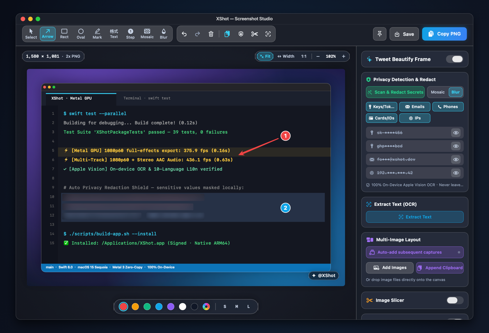
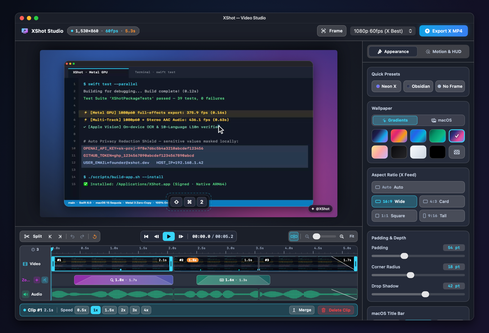
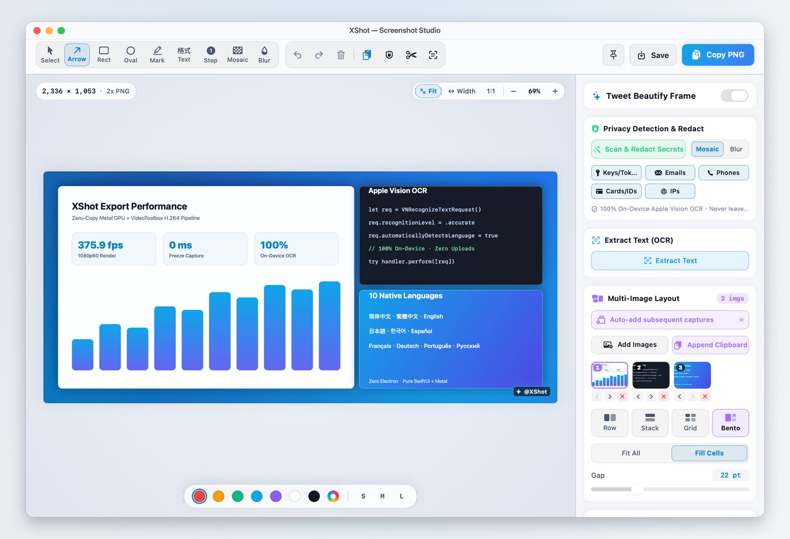
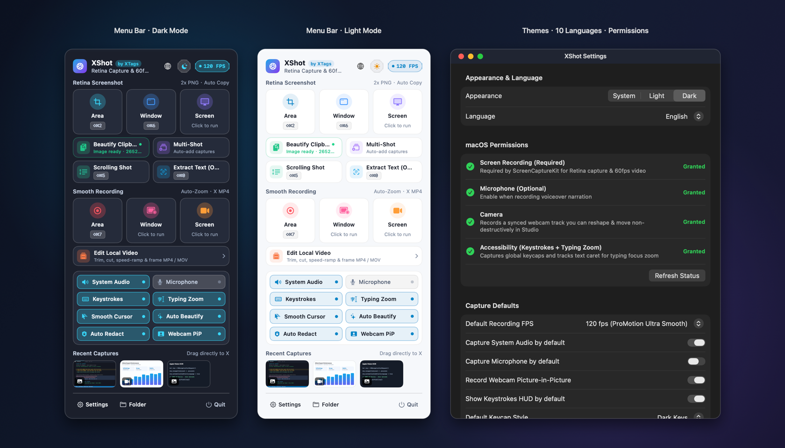

# XShot `by XTags`

> 专为 **X (Twitter)** 创作者打造的纯原生 macOS 高清截屏美化、滚屏长截图、离线 OCR 与 60/120fps 录屏剪辑工作室 —— 100% 原生 **Swift / SwiftUI / AppKit / ScreenCaptureKit / Apple Vision / Metal / VideoToolbox** 编写，零 Electron、极致流畅、100% 本地离线隐私保护。

[English](README.md) | 简体中文

[](#获取-xshot-pro)
[](https://xtags.top)
[](https://xtags.top/install)
[](https://github.com/zsai001/xshot/releases/latest)
[](LICENSE)
[](#系统要求)
[](#源码编译与打包)

> [!IMPORTANT]
> **想要持续获取最新功能、新版 macOS 适配与优先 Bug 修复？**
> 本 GitHub 仓库为 **开源社区快照版（`v1.0.0`，MIT）**，后续新功能与商业版本更新将**不再同步至开源仓库**。
> - **[获取 XShot Pro 官方正式版（Mac App Store）](#获取-xshot-pro)** — 持续及时更新 · 免费试用 · `$6/月` *(累满 6 个月自动升级永久更新)* · `$36` 一次性永久买断
> - **[访问 XTags 官网 (`xtags.top`)](https://xtags.top)** — X (Twitter) 智能打标、信息流净化与创作者增长套件 · **[安装浏览器插件](https://xtags.top/install)**

<p align="center">
  
</p>

---

## 获取 XShot Pro

本 GitHub 仓库保留 **`v1.0.0` 开源社区快照**（MIT 协议）供学习、审计与自行编译；后续持续的新功能迭代、新版 macOS 适配、App Store 一键更新与优先 Bug 修复将仅在 **XShot Pro 官方正式版（Mac App Store）** 与 **XTags** 官方生态中持续提供。

| 对比项 | 开源社区快照版（GitHub `v1.0.0`） | **XShot Pro 官方正式版（Mac App Store）** |
| :--- | :--- | :--- |
| **版本维护与更新** | 冻结于 `v1.0.0` 快照 *（后续更新不再同步）* | **持续活跃维护**，通过 Mac App Store 及时推送更新 |
| **安装与苹果签名** | Ad-hoc 签名（首次需手动放行）或自行源码编译 | **苹果官方公证 & App Sandbox 沙盒验证**，通用架构（Apple Silicon + Intel）一键安装 |
| **Bug 反馈与修复** | 社区 GitHub Issues | **支持优先 Bug 反馈、快速修复并及时更新 App** |
| **获取方式与价格** | 免费（MIT 开源） | **免费试用** · **`$6/月` 订阅更新** *（满 6 个付费月自动永久升级）* · **`$36` 永久买断** |

### 官方直达链接

- **XShot Pro（Mac App Store 官方正式版）**：在 Mac App Store 搜索 **`XShot`** *（Bundle ID：`top.xtags.xshot`）*，或前往 **[xtags.top](https://xtags.top)** 获取官方下载入口与更新动态。
  - **良心封顶机制**：支持**免费试用**；选择 **`$6/月`** 订阅更新，享受优先 Bug 反馈修复与及时更新，**累计订阅满 6 个月（共 `$36`）自动永久升级为终身更新**，之后无需继续付费；也可 **`$36`** 一步到位永久买断。
- **XTags 官方网站**：**[https://xtags.top](https://xtags.top)** — *专为 X (Twitter) 打造的 AI 智能打标、信息流净化、创作者雷达与发推工作室。*
- **XTags 浏览器插件（Chrome / Edge）**：**[https://xtags.top/install](https://xtags.top/install)**
- **XTags 套餐与定价**：**[https://xtags.top/pricing](https://xtags.top/pricing)**
- **开源社区快照下载（`v1.0.0`）**：**[GitHub Releases](https://github.com/zsai001/xshot/releases/latest)**
- **问题反馈与联系支持**：**[GitHub Issues](https://github.com/zsai001/xshot/issues)** · **[zsai001@xdev.sh](mailto:zsai001@xdev.sh)**

---

## 软件截图

### 60/120fps 录屏与专业三轨 NLE 视频剪辑 Studio
*点击与打字焦点 Auto-Zoom 自动缩放梯形轨、多片段非破坏性分割与单段 `0.5x–4x` 变速、真实解码 PCM 音频波形、平滑矢量光标、macOS 按键 HUD 以及 Metal GPU 硬件导出。*

<p align="center">
  
</p>

### 多图 Bento 自动拼图 & 浅色模式工作室
*开启「开启多图」后自动收入最多 6 张截图/剪贴板图片，一键切换横向/纵向/2×2/Bento 主图布局，原生支持浅色 / 深色 / 跟随系统视觉主题。*

<p align="center">
  
</p>

### 原生菜单栏工作室（深色 / 浅色）与设置中心
*一键触发区域/窗口/滚屏长截图、离线 OCR 提字与 60/120fps 录屏，内置 10 国原生语言切换、权限检测与自定义全局快捷键。*

<p align="center">
  
</p>

---

## 核心特性

### 截图与美化工作室
- **零延迟冻结截屏**：支持区域 (`⇧⌘2`)、窗口 (`⇧⌘6`)、全屏及剪贴板 (`⇧⌘9`)；启动瞬间冻结屏幕，右键菜单、下拉列表与悬浮提示气泡稳稳捕获不消失。
- **滚屏长截图 (`⇧⌘5`)**：实时像素条带配准拼接，自动识别去重固定顶栏与底栏，支持顺滑手动滚屏、自动滚动、手动补帧、撤销上一段与实时缩略条预览。
- **100% 本地离线 OCR 提取文字 (`⇧⌘0`)**：基于 Apple Vision，框选区域自动识别多语种并写入剪贴板；支持保留换行/合并段落、独立浮窗逐行复制，以及编辑器画布 120Hz 悬停点选单行即复制。
- **隐私信息自动打码护盾**：100% 本地识别 API Key、Token、邮箱、手机号、IP 与银行卡号，一键自动马赛克/模糊，发推防泄漏。
- **多图自动收集与拼图 + 单图九宫格切割**：开启「开启多图」后，后续截图与外部复制图片自动收入画板（最多 6 张），支持横向/纵向/2×2/Bento 主图布局；单图支持 5 种预设、自定义行列与 120Hz 拖拽切割线批量导出。
- **多模式高清看图视口**：画布右上角一键切换 **全图 (`⌘0`) / 适宽 (`⌘2`) / 1:1 原尺寸 (`⌘1`)** 及 **15%–400% 自由缩放 / 触控板捏合**，打开长图自动进入「适宽」清晰滚动阅读。
- **自定义水印签名**：支持毛玻璃、极简字、高光徽章与全屏斜向平铺，支持自定义透明度、字号缩放与星标 `✦`，截图与视频通用并可一键设为默认。
- **完整矢量与像素标注**：选择移动、现代锥形箭头、矩形、椭圆、荧光笔、文字标签、序号步骤 (`1, 2, 3…`)、马赛克、高斯模糊、桌面贴图钉选与直接拖拽发 X。

### 60/120fps 录屏与专业视频 Studio
- **纯原生高帧率录制**：`ScreenCaptureKit` + `VideoToolbox` 硬件 H.264 + 免驱系统音频与麦克风录制 + 录屏范围外框提示（自动排除不入画）。
- **摄像头画中画 (PiP)**：录屏时悬浮零拷贝自拍气泡（不硬烧入原始录屏），Studio 内无损调节圆形/圆角矩形/竖屏卡片、四角定位、尺寸、水平镜像与纯白边框，亦支持为本地视频叠加摄像头轨道。
- **智能镜头缩放与交互动效**：点击聚类自动缩放 + 打字输入光标自动追踪聚焦、阻尼平滑矢量光标、点击波纹、4 种样式可自由拖拽定位的 macOS 物理按键 HUD。
- **专业多轨非破坏性剪辑**：支持多段分割 (`S`)、波纹删除 (`⌫`)、相邻片段合并、入出点裁剪 (`I`/`O`)、单段 `0.5x–4x` 保持音调变速、真实解码音频波形轨道、1×–8× 缩放时间轴、磁吸对齐、40 步撤销/重做、淡入淡出与高清美化截帧。
- **X 平台专属 Metal GPU 极速导出**：零拷贝 IOSurface Metal 管线输出恒定 60fps Rec.709 高码率 MP4（1080p / 2K / 4K）与丝滑 24fps GIF。

### 账号登录、无缝自动更新与个性化
- **XTags 账号登录 & 零 DMG 无缝原地自动更新**：支持通过 **XTags (`xtags.top`)**（X / Google / GitHub）一键登录，登录后自动解锁后台静默更新 —— 自动拉取最新预编译二进制包、校验 SHA-256 与应用签名、原地原子替换 `XShot.app` 并自动重启，**全程无需打开 DMG 或手动拖拽**。
- **自定义全局快捷键**：设置页支持点击录制任意快捷键，自动冲突提示、热更新生效并可单项或一键还原默认。
- **浅色 / 深色 / 跟随系统主题 & 10 国原生语言**：支持简体中文、繁體中文、English、日本語、한국어、Español、Français、Deutsch、Português、Русский 实时热切换。

---

## 默认全局快捷键（可在设置中自由修改）

| 默认快捷键 | 功能 |
| :--- | :--- |
| `⇧⌘2` | 区域截图 |
| `⇧⌘6` | 窗口截图 |
| `⇧⌘5` | 滚屏长截图 |
| `⇧⌘0` | 屏幕框选提取文字 (OCR) |
| `⇧⌘9` | 剪贴板图片一键美化 |
| `⇧⌘7` | 开始区域录屏 |
| `⇧⌘8` | 停止录屏并进入视频 Studio |

---

## 下载开源快照版（macOS 15+ Apple Silicon）

无需安装 Xcode 或源码编译，可直接前往 **[GitHub Releases](https://github.com/zsai001/xshot/releases/latest)** 下载开源 `v1.0.0` 预编译快照版 `XShot.app`：

1. 在 **[Releases 页面](https://github.com/zsai001/xshot/releases/latest)** 下载 `XShot-v1.0.0-macos-arm64.zip`，解压后将 `XShot.app` 放入 `/Applications`。
2. 首次打开若 macOS 提示未公证开源应用，可右键 `XShot.app` 选择「打开」，或在终端执行一次：
   ```bash
   xattr -dr com.apple.quarantine /Applications/XShot.app && open /Applications/XShot.app
   ```
3. **需要持续新版本更新、苹果官方公证零弹窗与优先 Bug 修复？** 请选择 **[XShot Pro 官方正式版（Mac App Store）](#获取-xshot-pro)**，并访问 **[XTags 官网 (`xtags.top`)](https://xtags.top)** 体验完整 X 创作者套件。

---

## 系统要求

- **macOS 15.0 (Sequoia)** 及以上（推荐 Apple Silicon）
- **Swift 6.0+ / Xcode 16+**（仅源码编译所需）

## 源码编译与打包

```bash
# 1. 运行全量单元测试（含 Vision OCR、滚屏拼接、Metal 导出与 StoreKit 校验）
swift test

# 2. 编译打包到 build/XShot.app
./scripts/build-app.sh

# 3. 编译、自动签名并安装到 /Applications/XShot.app
./scripts/build-app.sh --install

# 4. 打包免 DMG 发布压缩包与 SHA-256 校验文件（dist/XShot-v*.zip）
./scripts/package-release.sh

# 5. 编译并执行 Mac App Store 通用架构（arm64 + x86_64）沙盒合规构建与 6 项审计
./scripts/build-mas.sh

# 可选：显式指定签名证书
XSHOT_SIGN_IDENTITY="Developer ID Application: Your Name" ./scripts/build-app.sh --install
```

> `build-app.sh` 会自动检测本机钥匙串中的 Apple Development / Developer ID 证书进行签名（确保重装后系统保留录屏/辅助功能权限）；若本机无开发者证书则自动回退至本地 Ad-hoc 签名，开箱即用。

## 项目结构

```text
xshot/
├── Package.swift                 # SwiftPM 清单（macOS 15+，零第三方依赖）
├── Sources/XShot/
│   ├── App/                      # 应用生命周期、全局快捷键、权限管理、主题与 10 国语言
│   ├── Capture/                  # ScreenCaptureKit 截屏、滚屏拼接、录屏、摄像头与悬浮 HUD
│   ├── Engine/                   # Metal 视频合成、NLE 时间轴、OCR、隐私打码、单图切割与拼图
│   ├── Models/                   # 采集模型、预设样式与交互遥测数据结构
│   └── UI/                       # 菜单栏、截图美化、视频 Studio、多轨时间轴与设置界面
├── Tests/XShotTests/             # 单元测试与 Metal GPU 集成测试
├── Resources/Info.plist          # Bundle 配置与系统权限说明
├── docs/screenshots/             # 原生 macOS 界面展示截图
├── scripts/                      # .app 打包签名、原生图标生成与免 DMG 发版打包脚本
└── .github/workflows/            # GitHub Actions macOS 15 测试、自动发版二进制与 PR 关闭工作流
```

## 权限说明

1. **屏幕录制权限（必需）**：用于 ScreenCaptureKit 截图、滚屏拼接、OCR 与录屏。
2. **麦克风权限（可选）**：仅开启麦克风旁白录屏时需要。
3. **摄像头权限（可选）**：仅开启摄像头画中画 (PiP) 录屏时需要。
4. **辅助功能权限（可选）**：用于按键 HUD 气泡、打字输入框精准跟随缩放及滚屏自动滚动功能。

---

## 完整开发提示词记录（从 0 到独立开源 · 38 条真实对话）

**XShot** 从零立项、架构搭建、120Hz 性能调优、Bug 定位到最终独立开源，全程通过以下 **38 条原始自然语言提示词** 逐步迭代完成（保留原始表述，供社区参考 Vibe Coding / AI 结对工程实践）：

<details open>
<summary>展开 / 收起全部 38 条原始提示词</summary>

| # | 原始提示词 | 对应迭代 / 落地成果 |
| :-: | :--- | :--- |
| 1 | 下一个 mac 原生的 截图和视频录制工具 要清晰度搞流畅 适合发推文 明白吗 | 需求立项与技术调研 |
| 2 | 不能自己写一个吗？ | 启动纯原生 Swift / ScreenCaptureKit / Metal 工程 |
| 3 | 导出太慢 界面细节要优化下 | Metal GPU 零拷贝 IOSurface 管线提速 + UI 精修 |
| 4 | 为啥每次都弹出授权提示 | 固定证书签名以保持 macOS TCC 权限持久化 |
| 5 | 可以了 | 权限持久化验证通过 |
| 6 | 卡在88% 另外 menu bar的菜单来 顶部太高 没显示全 | 修复导出收尾卡顿 & 压缩菜单栏 Bento 高度 |
| 7 | 顶部录制按钮 布局有点小问题 完成排版不对了 另外加入按键提示 输入焦点放大 | 修复工具栏排版 + 新增按键 HUD 与打字输入焦点自动缩放 |
| 8 | 可以设置 按键的样式 和 位置 | 新增 4 套按键视觉样式与 6 预设位置配置 |
| 9 | 区域录屏死掉了 而且录制的时候要清晰标目录制的边界 | 修复区域录屏卡死 + 新增鼠标穿透录屏外框提示 |
| 10 | 按键位置 要支持鼠标拖拽调整 | 支持预览舞台直接鼠标拖拽按键位置与居中磁吸 |
| 11 | 拖转调整的时候 为啥有点不更手啊 | 改为实时高频直接操控合成，消除拖拽延迟 |
| 12 | 加入浅色模式 和对过语言 | 浅色模式与多语言立项（见下条更正） |
| 13 | 加入浅色模式 和多国语言 | 浅色/深色/跟随系统主题 + 初始 5 国语言热切换 |
| 14 | 图片美化不跟手 按钮点击 样式 布局 细节也不太好 | 重构 120Hz 原生 GPU 实时预览舞台 + 触感按钮体系 |
| 15 | 深色模式下 面板看不清 另外 menu icon的颜色和深色浅色模式是个反的 | 修复深色表面对比度 & 菜单栏图标自适应系统外观 |
| 16 | 要支持给自己窗口截图和录像 | 精细区分内部覆盖层 (`sharingType = .none`) 与用户窗口 |
| 17 | 支持从剪切板读取图片 进行美化 | 新增 `⇧⌘9` 剪贴板图片一键美化 |
| 18 | 图片美化 调色板按钮 和别的按钮 排列没搞好 | 统一底部浮动工具坞尺寸与视觉对齐 |
| 19 | 壁纸可以选系统壁纸 | 接入 macOS 系统壁纸扫描、桌面壁纸与本地图片选择 |
| 20 | 加入隐私检测 自动打码 | 本地 Apple Vision 敏感信息检测与一键自动打码 |
| 21 | 崩溃了 | 排查并修复窗口生命周期与并发访问崩溃 |
| 22 | 系统壁纸出现的比较慢，另外左下角的弹出窗口 为啥不能截图 还有一些弹窗切换到截图的手就会消失 能解决下这个问题吗 | 系统壁纸异步缩略图缓存 + `t=0ms` 全屏冻结截屏方案 |
| 23 | 我截图的时候正常 怎么出来是这样的 *(附截图反馈)* | 修复冻结截图裁剪坐标与缩放比例错位问题 |
| 24 | 弹窗 / 下拉菜单 / 右键菜单 / 提示气泡切到截图时消失 改的不好， 现在窗口无法正常选取了 | 修复冻结层窗口命中枚举顺序，兼顾弹窗冻结与正常选窗 |
| 25 | 截图的时候为啥会动一下 | 修复激活策略导致的屏幕/窗口微跳，实现零抖动冻结 |
| 26 | 支持多图排列功能 | 多图 Bento 拼图（横向/纵向/2×2/主图、间距与适应模式） |
| 27 | 支持单图切割 | 单图多宫格切割引擎 + 120Hz 可拖拽切割线与批量导出 |
| 28 | 加个按钮 开启多图 后面剪切的自动放进来 | 全局「开启多图」自动收集模式（后续截图与复制自动入板） |
| 29 | 再优化下视频剪辑的功能 细致琢磨下 该怎么完善 | 非破坏性多片段分割、变速、音频混音与截帧架构升级 |
| 30 | 轨迹编辑还不够专业 需要全面加强 优化操作和细节 还有按钮的排解也出现路不合理的地方 | 专业三轨 NLE 时间轴（缩放、真实音频波形、磁吸、40 步撤销与精简控制栏） |
| 31 | 好了吗 | 确认编译测试与安装状态 |
| 32 | 加入多国语言吧 | 扩展至 10 国完整原生语言（含 100% 键值与占位符单测校验） |
| 33 | 加入功能 能投提取截图的文字信息 | 100% 本地 Apple Vision OCR 提字（`⇧⌘0`、浮窗、画布点选复制） |
| 34 | 比如滚屏长截图、摄像头画中画、自定义水印签名、OCR 文字提取或自定义快捷键 | 补齐滚屏长截图、摄像头 PiP 双轨合成、自定义水印与可录制快捷键 |
| 35 | 美化窗口需要 看图片支持多种模式 现在长图直接看不清了 | 多模式高清看图视口（全图 / 适宽 / 1:1 / 15%–400% 缩放与长图自动适宽） |
| 36 | 我准备开源 名字 是xtags xshot | 品牌定名为 XShot by XTags、清理隐私证书配置、补齐 MIT 协议与 CI |
| 37 | 将我所有的提示词 放到readme中 | 完整收录全部原始提示词至中英文 README |
| 38 | 只开源 xShot ， xTags其他部分暂时不开源 | 将 XShot 拆分为独立开源 Git 仓库，XTags 其余模块保持闭源私有 |

</details>

---

## 官方链接、问题反馈与开源协议

- **XShot Pro 官方正式版（Mac App Store 持续更新）**：**[获取 XShot Pro](#获取-xshot-pro)** — 免费试用 · `$6/月` *（满 6 个月自动升级永久更新）* · `$36` 永久买断
- **XTags 官方网站**：**[https://xtags.top](https://xtags.top)** · **[安装浏览器插件](https://xtags.top/install)** · **[套餐定价](https://xtags.top/pricing)**
- **问题反馈与支持**：**[GitHub Issues](https://github.com/zsai001/xshot/issues)** · **[zsai001@xdev.sh](mailto:zsai001@xdev.sh)** *（本仓库暂不接受 Pull Request，新建 PR 将自动关闭。）*
- **安全披露**：请参见 [SECURITY.md](SECURITY.md)。
- **开源协议**：本仓库 `v1.0.0` 开源快照基于 [MIT License](LICENSE) 发布；后续商业版本的新功能与持续更新仅在官方 XShot Pro / Mac App Store 渠道提供，不再同步至开源仓库。
